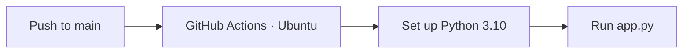

# DevOps class · Python workflow

A small Python app that prints a greeting and the current UTC time.





## Try locally

```bash
python3 app.py
```

## Repository guide

| File | Purpose |
| --- | --- |
| [app.py](app.py) | Greeting and timestamp program. |
| [.github/workflows/actions_lab.yaml](.github/workflows/actions_lab.yaml) | Workflow triggered by pushes to main. |

The workflow runs the app directly; its dependency-install step is commented out.
